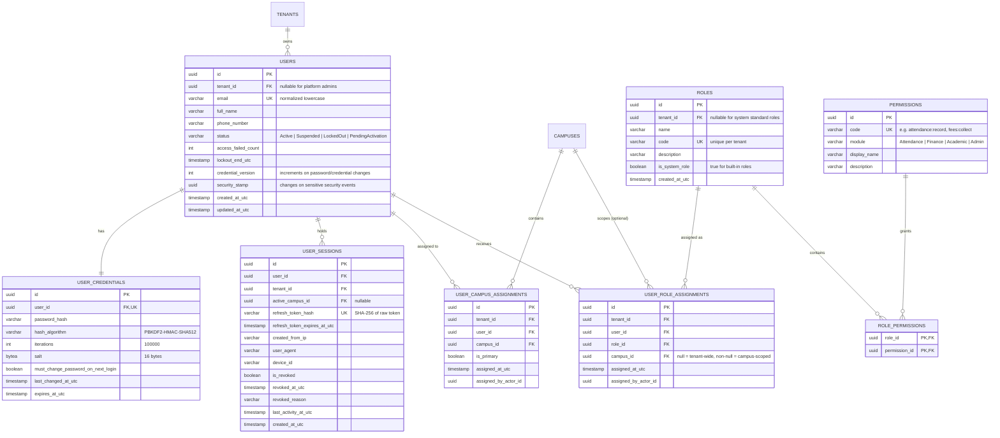
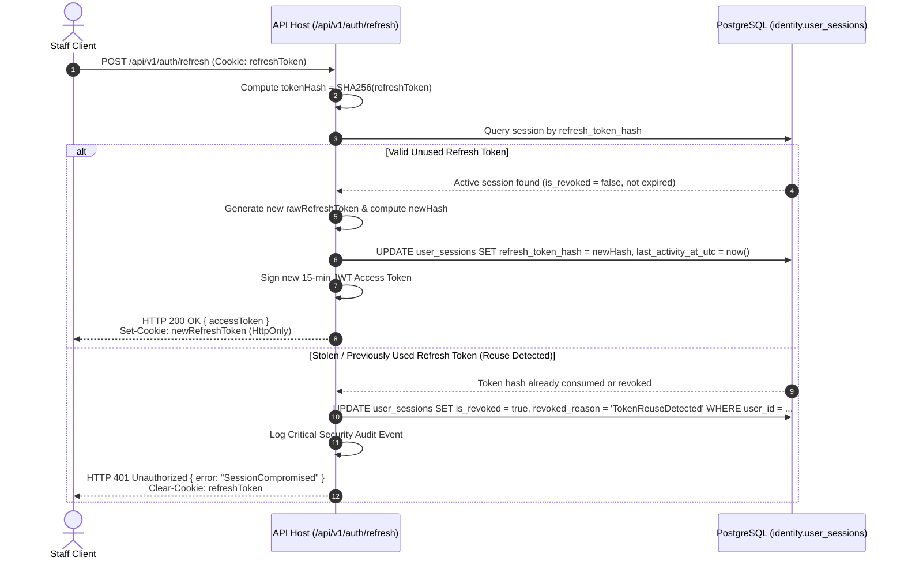

# 42 — Phase 1B: Identity, Scoped RBAC & Local-First Authentication Architecture

- **Status:** Approved Architecture Specification
- **Date:** 2026-11-11
- **Phase:** Phase 1B (Platform & Tenancy Foundation — Identity & Access)
- **Dependencies:** Phase 1A.1 Verified Foundation (`commit 8e84995`), `ADR-022`, `ADR-023`, `ADR-024`

---

## 1. Executive Summary & Architectural Scope

Phase 1B implements the **Identity, Scoped Role-Based Access Control (RBAC), and Authentication Subsystem** for SchoolOS. Building upon the verified Phase 1A multi-tenant persistence foundation, Phase 1B establishes cryptographic authentication and fine-grained authorization for both the **Cloud Control Plane** and autonomous **Local Data Plane** campus nodes.

### Core Architecture Tenets
1. **Separation of Concerns:** Separate Cloud Control Plane identity from Local Data Plane identity stores. Local campus nodes must operate 100% offline without cloud availability during normal daily operations.
2. **Credential Containment:** A compromised campus node must never compromise other campuses or the Cloud Control Plane. No indiscriminate global password hash replication.
3. **Scoped RBAC (No Overengineering):** Pure hierarchical scoped RBAC (Global Catalog -> Tenant Roles -> Campus-Scoped Assignments). No unneeded dynamic ABAC engine.
4. **Zero-Trust Scope Validation:** Server endpoints never trust client-supplied scope headers (`X-Tenant-Id`, `X-Campus-Id`) without validating cryptographic token claims and active database assignments.
5. **Standardized Cryptography:** ASP.NET Core Identity `PasswordHasher<User>` (PBKDF2-HMAC-SHA512). Zero custom cryptographic implementations.
6. **Defense-in-Depth Session Lifecycle:** Short-lived access tokens (15 mins), rotating hashed refresh tokens with automatic breach/reuse detection, and instant global session invalidation via monotonic `CredentialVersion`.
7. **Frontend Storage Discipline:** In-memory access token storage, `HttpOnly`/`SameSite=Strict` cookies for refresh tokens. Zero long-lived refresh tokens in persistent `localStorage`.

---

## 2. Separate Cloud and Local Authentication

SchoolOS operates under two fundamentally distinct operational topologies:

| Dimension | Cloud Control Plane (`SchoolOS.Cloud.Api`) | Local Data Plane (`SchoolOS.Local.Api`) |
| :--- | :--- | :--- |
| **Operational Purpose** | Multi-tenant SaaS management, onboarding, billing, customer portal, platform analytics | Autonomous school campus operations (attendance, fee receipts, examinations, grading) |
| **Target User Base** | Platform super-administrators, support engineers, tenant account owners | Principals, campus administrators, teachers, accountants, staff, students, parents |
| **Data Store** | Cloud PostgreSQL (`platform` schema) | Campus Local PostgreSQL (`identity` and `organization` schemas) |
| **WAN Dependency** | Requires active internet connectivity | **Zero internet dependency**; 100% autonomous on campus LAN |
| **JWT Issuer (`iss`)** | `https://cloud.schoolos.internal` (or custom SaaS domain) | `https://campus-{campusId}.schoolos.local` |
| **JWT Audience (`aud`)** | `schoolos-cloud-control-plane` | `schoolos-local-data-plane` |
| **Signing Key Management** | Asymmetric RSA-4096 / ECDSA P-256 managed via Key Vault (`kid: cloud-2026-v1`) | Asymmetric RSA-2048 / ECDSA P-256 generated at node provisioning, private key locked in DPAPI/Keyring (`kid: campus-{campusId}-v1`) |
| **Credential Scope** | Platform users and tenant account owners | **Only** staff and users assigned to that specific campus |

> [!IMPORTANT]
> **No Global Hash Synchronization:** The Cloud Control Plane never pushes credentials of Tenant A to Tenant B, nor does it push credentials of Campus 1 staff to Campus 2 nodes unless a user holds an explicit multi-campus assignment.

---

## 3. Identity and Credentials Data Model

### 3.1 Entity Architecture

The identity data model separates the core `User` identity aggregate from credentials and sessions to prevent accidental leakage in user profile queries.



### 3.2 Staff & Profile Relationships
Following modular monolith bounded context design:
- The `Identity` module owns `User`, `UserCredential`, and `UserSession`.
- The `Staff` entity belongs to the `HumanResources`/`Staff` module (Phase 2), referencing `UserId` as an external identifier.
- The `Identity` module does not depend on `Staff` or `Student` modules.

### 3.3 Password Hashing Algorithm Selection & Configuration
- **Selected Algorithm:** **ASP.NET Core Identity `PasswordHasher<User>` (PBKDF2 with HMAC-SHA512)**.
- **Evaluation Rationale:**
  - *Argon2id:* Outstanding memory-hardness, but requires native C library wrappers (`libsodium` or `Konscious.Security.Cryptography`), introducing unmanaged binary compatibility risks across Windows x64, Linux Alpine, and low-power ARM64 local gateways.
  - *ASP.NET Core `PasswordHasher<User>`:* Built into the standard .NET 10 BCL, zero third-party dependencies, NIST SP 800-63B compliant, FIPS-compliant, and 100% portable across cloud and edge hardware.
- **Cryptographic Specifications:**
  - Format: Identity Version 3 (1-byte header + 4-byte PRF + 4-byte iteration count + 4-byte salt length + salt + subkey).
  - PRF: HMAC-SHA512.
  - Salt: 128-bit (16 bytes) cryptographically secure random bytes via `RandomNumberGenerator`.
  - Iterations: **100,000 iterations**.
  - Subkey Size: 256-bit (32 bytes).
  - Comparison: Constant-time bitwise comparison to eliminate timing side-channel vulnerabilities.
  - **Custom Cryptography Ban:** No developer-written hashing or salt generation is permitted.

### 3.4 CredentialVersion & SecurityStamp Mechanics
- `CredentialVersion` (integer): Defaults to `1`. Incremented atomically upon:
  1. Password change or reset.
  2. Administrative account lockout or suspension.
  3. Forced global session invalidation.
- The JWT access token embeds `cv: <int>`. On every API request, the server or authorization handler verifies `token.cv == user.CredentialVersion`. If `token.cv < user.CredentialVersion`, the token is rejected immediately with HTTP 401.
- `SecurityStamp` (UUID string): Updated upon email change, 2FA credential modification, or account ownership transfer.

### 3.5 Offline Password Reset & Supervised Vouchers
During WAN outages, cloud email/SMS verification is unreachable:
1. A designated `CampusAdmin` or `Principal` initiates an offline supervised reset at `POST /api/v1/auth/offline-reset-voucher`.
2. The local node verifies the administrator's authorization and active campus scope.
3. The node generates a cryptographically random, one-time temporary password (voucher) for the staff member, sets `MustChangePasswordOnNextLogin = true`, increments `CredentialVersion`, and revokes all active sessions for that user.
4. An `EmergencyCredentialResetEvent` containing the administrator's actor ID, target user ID, and timestamp is appended to the local transactional Outbox for audit reconciliation when internet restores.

---

## 4. Scoped RBAC Architecture

SchoolOS implements **Hierarchical Scoped Role-Based Access Control (RBAC)**.

### 4.1 Permission Catalog vs Scoped Assignments

1. **Global Permissions Catalog (`identity.permissions`):**
   - System-wide, immutable catalog of operational permissions.
   - Seeded at migration time.
   - **No `tenant_id` column.**
   - **Zero RLS applied.** Universally readable by all tenants.
2. **Roles (`identity.roles`):**
   - **System Standard Roles (`tenant_id IS NULL`):** `PlatformAdmin`, `TenantAdmin`, `CampusAdmin`, `Principal`, `AcademicCoordinator`, `Teacher`, `Accountant`, `Librarian`, `Student`, `Parent`.
   - **Custom Roles (`tenant_id IS NOT NULL`):** Created by tenant administrators for custom operational delegation.
   - RLS Policy: `USING (tenant_id IS NULL OR tenant_id = NULLIF(current_setting('app.current_tenant_id', true), '')::uuid)`.
3. **Role Assignments (`identity.user_role_assignments`):**
   - **Tenant-Scoped Assignment (`campus_id IS NULL`):** Grants the role across the entire school group (e.g. Group CEO, Central Finance Director).
   - **Campus-Scoped Assignment (`campus_id IS NOT NULL`):** Grants the role *strictly* within that specific campus (e.g. Teacher at Campus West).
   - Database Constraint:
     ```sql
     CONSTRAINT fk_user_role_assignments_campus
     FOREIGN KEY (tenant_id, campus_id)
     REFERENCES organization.campuses (tenant_id, id)
     ON DELETE CASCADE;
     ```
   - RLS Policy: Strict tenant isolation (`tenant_id = current_tenant_id()`).

### 4.2 Standard Role & Permission Matrix

| Module | Permission Code | PlatformAdmin | TenantAdmin | CampusAdmin | Principal | Teacher | Accountant | Parent / Student |
| :--- | :--- | :---: | :---: | :---: | :---: | :---: | :---: | :---: |
| **Platform** | `platform:manage` | **Yes** | No | No | No | No | No | No |
| **Organization** | `tenant:update` | **Yes** | **Yes** | No | No | No | No | No |
| **Organization** | `campus:manage` | **Yes** | **Yes** | **Yes** (Scoped) | No | No | No | No |
| **Identity** | `users:manage` | **Yes** | **Yes** | **Yes** (Scoped) | No | No | No | No |
| **Identity** | `roles:assign` | **Yes** | **Yes** | **Yes** (Scoped) | No | No | No | No |
| **Academics** | `classes:manage` | No | **Yes** | **Yes** (Scoped) | **Yes** (Scoped) | No | No | No |
| **Attendance** | `attendance:record` | No | **Yes** | **Yes** (Scoped) | **Yes** (Scoped) | **Yes** (Scoped) | No | No |
| **Attendance** | `attendance:view` | No | **Yes** | **Yes** (Scoped) | **Yes** (Scoped) | **Yes** (Scoped) | No | **Yes** (Self) |
| **Finance** | `fees:collect` | No | **Yes** | **Yes** (Scoped) | No | No | **Yes** (Scoped) | No |
| **Finance** | `reports:financial`| No | **Yes** | **Yes** (Scoped) | **Yes** (Scoped) | No | **Yes** (Scoped) | No |

---

## 5. JWT, Session & Refresh Token Lifecycle

### 5.1 Token Specifications & Claims Structure

Each issued JWT access token includes standard, security, and authorization claims:

```json
{
  "sub": "01931a74-8b20-7f21-9988-112233445566",
  "tid": "01931a74-8b10-7e10-8877-001122334455",
  "cid": "01931a74-8b15-7f15-9988-aabbccddeeff",
  "email": "teacher.sarah@westcampus.schoolos.pk",
  "name": "Sarah Ahmed",
  "roles": ["Teacher", "AcademicCoordinator"],
  "perms": ["attendance:record", "attendance:view", "grades:enter"],
  "cv": 1,
  "sid": "01931a74-8c01-7001-a1b2-c3d4e5f60718",
  "iss": "https://campus-west.schoolos.local",
  "aud": "schoolos-local-data-plane",
  "exp": 1794356100,
  "nbf": 1794355200,
  "jti": "01931a74-8c05-7005-b2c3-d4e5f6a7b8c9"
}
```

- Header: `{"alg": "RS256", "typ": "JWT", "kid": "campus-west-2026-v1"}`.
- **Access Token Lifetime:** **15 minutes**.
- **Refresh Token Lifetime:** **7 days** (Cloud Control Plane) / **24 hours** (Local Campus Node).

### 5.2 Refresh Token Storage, Rotation & Reuse Detection

1. **Storage:**
   - Raw refresh token is a 256-bit cryptographically secure string (`RandomNumberGenerator`).
   - The database stores **only** the SHA-256 hash (`refresh_token_hash`).
   - Raw token is returned to the client in an `HttpOnly`, `Secure`, `SameSite=Strict` cookie.
2. **Rotation:**
   - Every refresh request swaps the refresh token for a newly generated one. The old hash is updated.
3. **Compromise / Token Reuse Detection:**
   - If a client attempts to present a previously rotated or revoked refresh token, the server detects token theft (e.g. an attacker intercepted the old token).
   - **Immediate Action:** The entire session `sid` and all descendant tokens are marked `is_revoked = true, revoked_reason = 'TokenReuseDetected'`.
   - Returns HTTP 401 Unauthorized and alerts security observability channels.

### 5.3 Campus Context Switching Workflow
A staff member assigned to multiple campuses switches their active workspace:
1. Client calls `POST /api/v1/auth/switch-context` with `{ "targetCampusId": "..." }`.
2. The server queries `identity.user_campus_assignments` to verify that `user_id` has an active assignment for `targetCampusId` under `tenant_id`.
3. If verified:
   - Recalculates roles and permissions scoped to `targetCampusId`.
   - Updates `UserSession.ActiveCampusId`.
   - Issues a newly signed 15-minute access token carrying the new `cid` and scoped `roles`/`perms`.
4. **Security Principle:** The server NEVER trusts client-supplied headers without server-side database validation.

---

## 6. Authentication Sequence Diagrams

### 6.1 Local Campus Offline Login & JWT Validation

```mermaid
sequenceDiagram
    autonumber
    actor Staff as Campus Staff (Browser)
    participant LocalAPI as Local Host (SchoolOS.Local.Api)
    participant AuthEngine as Identity Service & PasswordHasher
    participant LocalDB as Local PostgreSQL (PostgresTenantSessionInterceptor)

    Staff->>LocalAPI: POST /api/v1/auth/login<br/>{ email, password, campusId }
    Note over LocalAPI: WAN is offline; zero cloud pings
    LocalAPI->>LocalDB: Query user & credentials by email for campusId
    LocalDB-->>LocalAPI: User, UserCredential (PBKDF2 hash, salt), Roles, Permissions
    LocalAPI->>AuthEngine: VerifyHashedPassword(hash, password)
    AuthEngine-->>LocalAPI: PasswordVerificationResult.Success
    LocalAPI->>LocalDB: Create UserSession (store SHA-256 of refresh token)
    LocalAPI->>LocalAPI: Sign JWT Access Token (15 mins, kid=campus-v1)<br/>using Node Private Key (DPAPI)
    LocalAPI-->>Staff: HTTP 200 OK<br/>Body: { accessToken, user, campus }<br/>Set-Cookie: refreshToken (HttpOnly, Secure, SameSite=Strict)

    Staff->>LocalAPI: GET /api/v1/attendance/today (Bearer AccessToken)
    LocalAPI->>LocalAPI: Validate JWT signature with Node Public Key<br/>Verify cv == user.CredentialVersion
    LocalAPI->>LocalDB: SELECT set_config('app.current_tenant_id', tid, false)
    LocalDB-->>LocalAPI: Tenant scoped query results
    LocalAPI-->>Staff: HTTP 200 OK (Attendance records)
```

### 6.2 Refresh Token Rotation & Breach Detection



---

## 7. Frontend Authentication Architecture

### 7.1 State Management & Token Discipline (`frontend/schoolos-web`)

- **Context Provider:** `src/context/AuthContext.tsx`.
- **Custom Hook:** `useAuth()`.
- **Token Storage Rule:**
  - `accessToken` is stored **strictly in React application memory** (state variable).
  - `refreshToken` is stored in an **`HttpOnly`, `Secure`, `SameSite=Strict` cookie** managed by the backend server.
  - **No `localStorage` for tokens:** Long-lived tokens in `localStorage` are vulnerable to XSS and malicious dependencies. Storing in memory + HttpOnly cookie protects against token theft.

### 7.2 Automatic Silent Refresh Interceptor
An Axios/Fetch response interceptor handles token renewal:
1. 60 seconds before token expiration (calculated from JWT `exp`), a background timer calls `POST /api/v1/auth/refresh`.
2. If an API request returns HTTP 401, the interceptor queues pending requests, executes refresh once, and replays failed requests with the new token.
3. If refresh fails, cleans up auth state and redirects to `/auth/login`.

### 7.3 Protected Route Guards
```tsx
// React Route Guard Specification
<Route element={<ProtectedRoute requiredRoles={['Teacher', 'CampusAdmin']} />}>
  <Route path="/attendance" element={<AttendancePage />} />
  <Route path="/grades" element={<GradesPage />} />
</Route>
```

---

## 8. API Endpoint Contracts

### 8.1 `POST /api/v1/auth/login`
- **Request:**
  ```json
  {
    "email": "sarah.ahmed@schoolos.pk",
    "password": "CorrectHorseBatteryStaple123!",
    "campusId": "01931a74-8b15-7f15-9988-aabbccddeeff"
  }
  ```
- **Response (200 OK):**
  ```json
  {
    "accessToken": "eyJhbGciOiJSUzI1NiIsIn...",
    "expiresIn": 900,
    "user": {
      "id": "01931a74-8b20-7f21-9988-112233445566",
      "email": "sarah.ahmed@schoolos.pk",
      "fullName": "Sarah Ahmed",
      "tenantId": "01931a74-8b10-7e10-8877-001122334455",
      "activeCampusId": "01931a74-8b15-7f15-9988-aabbccddeeff",
      "roles": ["Teacher"],
      "permissions": ["attendance:record", "attendance:view"]
    }
  }
  ```
  *Header:* `Set-Cookie: schoolos_rt=...; HttpOnly; Secure; SameSite=Strict; Path=/api/v1/auth/refresh; Max-Age=86400`

### 8.2 `POST /api/v1/auth/switch-context`
- **Request:**
  ```json
  {
    "targetCampusId": "01931a74-8b18-7f18-bb99-001122334455"
  }
  ```
- **Response (200 OK):**
  ```json
  {
    "accessToken": "eyJhbGciOiJSUzI1NiIsIn...",
    "expiresIn": 900,
    "activeCampusId": "01931a74-8b18-7f18-bb99-001122334455",
    "roles": ["AcademicCoordinator"],
    "permissions": ["attendance:view", "reports:academic"]
  }
  ```

---

## 9. Phase 1B Implementation Milestones & Acceptance Criteria

Phase 1B will execute in four controlled, verifiable milestones:

| Milestone | Title | Key Deliverables | Verification / Acceptance Criteria |
| :--- | :--- | :--- | :--- |
| **Milestone 1B.1** | User Domain, Credentials & Password Hashing | `User`, `UserCredential`, `UserSession` entities, `PasswordHasher<User>` (PBKDF2), EF Core migration (`identity` schema). | Unit tests verify constant-time hash verification, salt generation, immutability, and audit attribution. |
| **Milestone 1B.2** | Scoped RBAC Engine & DB Constraints | `Role`, `Permission`, `UserRoleAssignment` entities, composite FK to `campuses`, seed catalog, custom authorization handlers. | Unit and architecture tests verify tenant and campus scoping; RLS policies validated against live PostgreSQL. |
| **Milestone 1B.3** | Cloud & Local Token Issuance (ADR-023) | Separate Cloud/Local JWT issuers, asymmetric key handling, login/refresh/switch-context endpoints, reuse detection. | Integration tests verify HTTP 200 on login, 401 on invalid/expired credentials, 401 on reuse detection, 403 on missing permissions. |
| **Milestone 1B.4** | Frontend Auth Provider & Navigation | React `AuthContext`, `useAuth`, in-memory token management, silent refresh, route guards, campus switcher. | `npm run build` passes with zero errors; Cypress/Playwright login and context-switching flows pass. |

---

## 10. Architectural Sign-off & Recommendations

1. **Phase 1A Closure:** Commit [`c35dbcb`](file:///d:/My%20Folder/My%20Work/SchoolOS) pushed to `origin/feature/phase-1-platform-foundation`. All 62 backend tests and frontend builds pass cleanly with 0 CVEs.
2. **Merge Readiness:** Pull Request targeting `main` has 0 merge conflicts and is ready for merge.
3. **Phase 1B Readiness:** Architectural design conflicts regarding separate cloud/local authentication, password hashing, scoped RBAC, and refresh token security have been resolved and codified in this document and `ADR-023`.
4. **Implementation Command:** Do not write Phase 1B implementation code until Phase 1A PR is merged into `main`.
