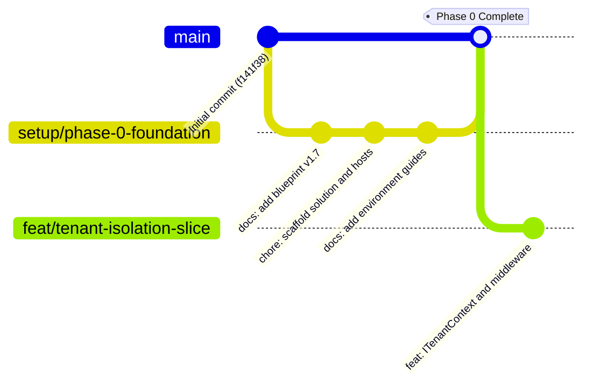

# SchoolOS — Git Workflow & Branching Strategy

**Target Audience:** SchoolOS Engineering Team  
**Canonical Remote:** `origin = https://github.com/a-kabeer/SchoolOS.git`  
**Primary Production Branch:** `main`  
**Approved Phase 0 Feature Branch:** `setup/phase-0-foundation`  

---

## 1. Branching Model



### 1.1 Branch Rules
- **`main`:** Protected production baseline. Direct commits and force-pushes are strictly prohibited. All changes must arrive via reviewed pull requests.
- **`setup/*`:** Foundation, build infrastructure, tooling and CI/CD pipelines.
- **`feat/*`:** New feature or module slices (e.g., `feat/tenant-isolation-slice`, `feat/fee-billing`).
- **`fix/*`:** Bug fixes and security patches.
- **`docs/*`:** Non-code architectural documentation and ADR additions.

---

## 2. Commit Message Standards

SchoolOS adopts the **Conventional Commits** specification:

```text
<type>(<scope>): <short imperative summary>

[optional detailed body explaining why, trade-offs and references]

[optional footer, e.g., Closes #123, Refs: ADR-021]
```

### Allowed Types:
- `feat`: A new user-facing capability or API endpoint.
- `fix`: A bug fix or reconciliation defect resolution.
- `chore`: Build configuration, dependencies, package updates.
- `docs`: Documentation, ADRs, comments.
- `refactor`: Code change that neither fixes a bug nor adds a feature.
- `test`: Adding or correcting automated tests.

---

## 3. Pull Request & Review Gates

Every Pull Request targeting `main` must satisfy:
1. **Compilation:** `dotnet build` and `npm run build` pass with zero errors.
2. **Architecture Tests:** NetArchTest rules verify zero circular dependencies or domain boundary leaks.
3. **Unit & Integration Tests:** 100% test pass rate with Testcontainers.
4. **Secret Scanning:** No API keys, certificates or database passwords committed.
5. **Human Review:** At least one Senior Architect / Lead review sign-off.
